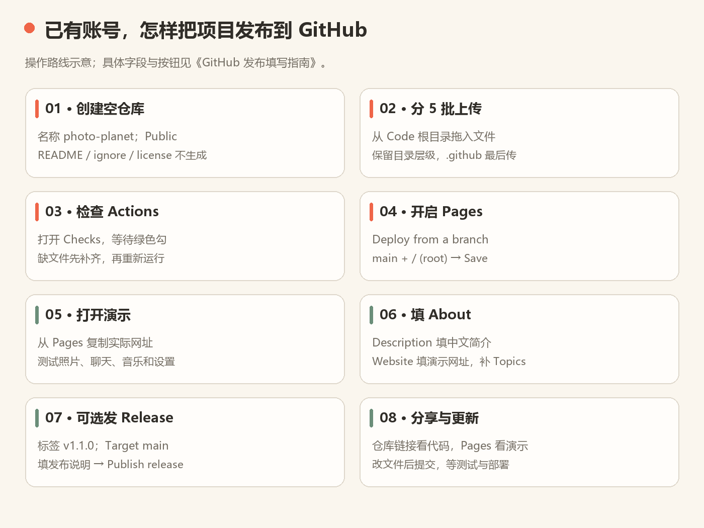
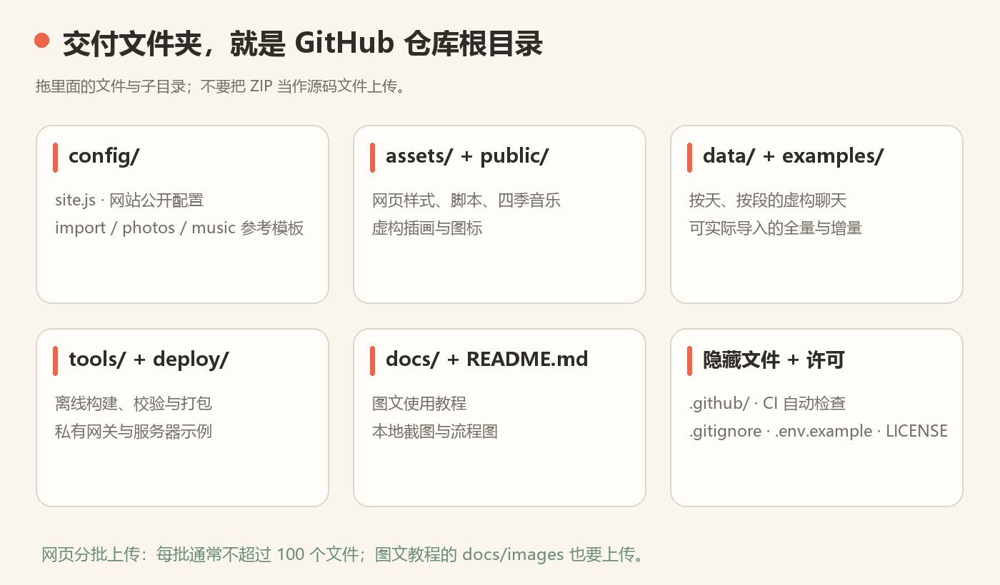
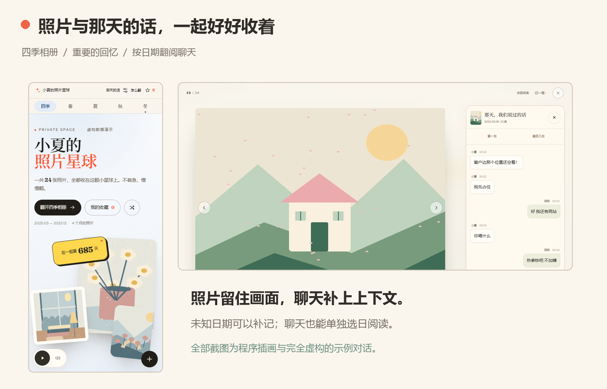

# GitHub 发布填写指南：每一项填什么

适用情况：**你已经有 GitHub 账号，现在只想把这个项目公开发布。** 不用注册账号、不用配置 OSS、不用部署私人服务器，也不用执行 Git 命令。

本次上传的是已经准备好的公开演示文件夹。按下面完成“创建仓库 → 上传源码”，别人就能看见和下载项目；再开启 Pages，别人就能直接打开网页体验；Release 是可选的版本下载入口。



## 第 1 步：打开 GitHub，创建一个空仓库

1. 打开 <https://github.com/>，登录你自己的账号。
2. 右上角找到 **`+` → `New repository`**。也可以直接打开 <https://github.com/new>。
3. 按下表填写。GitHub 界面可能有轻微改版，遇到表中没有的可选项目，保持默认即可。

| 页面上的字段 | 你怎么填／怎么选 | 说明 |
| --- | --- | --- |
| **Repository template**（如果有） | `No template`，或保持未选 | 本地已有完整项目，不套别的模板 |
| **Owner** | 选择你自己的 GitHub 账号 | 通常默认就是自己；无需另建组织 |
| **Repository name** | `photo-planet` | 这是仓库名，也是将来演示地址的一部分；提示重名时可用 `four-seasons-photo-planet` |
| **Description** | 复制下面的“仓库简介” | 可用中文，不影响代码 |
| **Visibility / Choose visibility** | **`Public`** | 公开源码；所有人可查看此仓库及其中虚构数据 |
| **Add README / Add a README file** | **关闭／不勾选** | 文件夹里已准备好 README，不需要 GitHub 生成第二份 |
| **Add .gitignore** | **`None` / 不添加** | 文件夹里已有 `.gitignore` |
| **Choose a license / Add license** | **`None` / 不添加** | 文件夹里已有 MIT `LICENSE` 和字体许可；这里选 None 不代表最终没有许可证 |

**仓库简介，整段复制：**

```text
一个按四季收藏照片、按日期翻阅聊天的回忆相册。支持照片与微信导出记录联动、四季配乐平滑切换、手机平板浏览和集中配置，附虚构演示数据与图文教程。
```

确认是 **Public**，其他初始化开关保持关闭，点击绿色 **`Create repository`**。

完成后会到空仓库的 **Quick setup** 页面。它下面会给很多终端命令，你本次用网页上传，可以直接看下一步，不用复制那些命令。

## 第 2 步：找到上传入口与本地文件夹

在空仓库页面点击 **`uploading an existing file`**。如果仓库里已经有文件，则点击 **`Add file` → `Upload files`**。

在电脑上打开交付的 **`photo-planet-GitHub`** 文件夹，里面应直接看到：

```text
README.md
GitHub发布填写指南.md
开始使用.md
index.html
chat.html
config/
assets/
data/
docs/
……
```

**拖文件夹里面的文件与子目录，不要把 `photo-planet-GitHub` 这个外层目录一起拖进去。**

上传后仓库根目录必须直接有 `index.html`。不要把整个 ZIP 传成唯一文件，那样只会有下载包，没有可浏览的源码和正常展示的 README。



## 第 3 步：按这 5 批上传，避免文件数量超限

GitHub 网页通常一次最多 100 个文件、单文件不超过 25 MiB。本项目文件较多，**不要一次拖整个项目**。当前交付的单文件大小均低于网页上传限制，按下表分批即可。

每次都回到仓库的 **Code 根目录**，再点击 `Add file → Upload files`。不要先进入 `assets` 等子目录再拖文件夹，否则会意外出现 `assets/assets/`。

| 批次 | 这一批拖哪些内容 | 建议提交说明 |
| --- | --- | --- |
| **1** | 根目录所有文件 + `config/` + `docs/` | `docs: add project introduction and configuration` |
| **2** | `assets/` + `LICENSES/` | `feat: add website assets and seasonal music` |
| **3** | `data/` + `demo-media/` + `examples/` | `feat: add fictional album and chat demo` |
| **4** | `public/` + `tools/` + `deploy/` + `tests/` | `feat: add demo art, import tools and deployment examples` |
| **5** | **`.github/`** | `ci: add automated checks` |

`.github/` 放最后上传，是因为它里面的工作流会立即检查项目；其他文件都齐了再上传，可以避免中途因文件缺失导致检查失败。

“根目录所有文件”包括 `.gitignore`、`.gitattributes`、`.dockerignore`、`.env.example` 等点开头的文件。Windows 文件管理器若看不见它们，可在“查看 → 显示 → 隐藏的项目”中开启显示。交付目录里没有 `.git` 历史；如果你之后自行生成了 `.git/`，不要上传它。

### 每一批下面的 Commit changes 怎么填

| 页面上的字段／选项 | 你怎么填／怎么选 |
| --- | --- |
| **Commit changes / Commit message** 第一行 | 复制上表当前批次的“建议提交说明”；写中文也可以 |
| **Extended description / Add an optional extended description** | **留空** |
| **Commit directly to the main branch**（如果有） | **选择这一项**，直接提交到主分支 |
| **Create a new branch… / Start a pull request** | 首次发布不选这一项 |
| 页面底部按钮 | 点击绿色 **`Commit changes`** |

第一次提交时可能没有分支选择，直接提交即可。默认主分支一般叫 `main`；如果你的仓库实际叫 `master`，后面选择对应的实际主分支，不要为了名字再多建一条分支。

等待当前这批提交完成，再回到 **Code 根目录** 上传下一批。不要在上传仍进行时关闭页面。

### 上传完成，根目录应有这些东西

| 类型 | 检查内容 |
| --- | --- |
| 页面与入口 | `README.md`、`index.html`、`chat.html`、`start.cmd` |
| 站点配置 | `config/site.js` |
| 静态资源 | `assets/`、`public/`、`demo-media/` |
| 示例数据 | `data/`、`examples/` |
| 工具与服务示例 | `tools/`、`deploy/`、`tests/` |
| 图文教程 | `docs/`，尤其 `docs/images/` |
| 字体与许可 | `LICENSE`、`ASSETS.md`、`LICENSES/` |
| 自动检查 | `.github/workflows/checks.yml` |

看到仓库下方自动展示图文 README，点击文档图片能正常打开，说明文档资源已上传。到这一步，**源码已经公开发布成功**。

## 第 4 步：让 GitHub 检查文件是否上传完整

1. 点击仓库上方 **`Actions`**。
2. 如果出现首次启用工作流提示，点击含 **`Enable`** 或 **`I understand my workflows, go ahead and enable them`** 的确认按钮；没有提示就跳过。
3. 找到 **`Checks`**，打开最新一次运行。
4. 等运行结束：绿色勾号表示通过；黄色表示还在执行；红色表示失败。

工作流会检查站点配置、Node 与 Python 测试、虚构数据和浏览器流程。首次运行会安装依赖与浏览器，耗时取决于 GitHub 排队情况。

**如果失败：**先看具体红色步骤。`file not found`、`Cannot find module`、缺少 Python 文件通常要回头检查是否漏上传了整个目录；不要只删掉检查来让它变绿。补齐后可在失败运行页选择 **`Re-run jobs → Re-run all jobs`**。如果是依赖下载或网络临时失败，也可以在确认文件齐全后重试。

## 第 5 步：开启可直接访问的网页演示

这一步是让别人不用下载源码，就能在浏览器里体验。**只发布当前虚构演示，不上传自己的私人照片和微信记录。**

1. 进入这个仓库的 **`Settings`**，不是右上角头像里的个人 Settings。
2. 左侧菜单找到 **`Pages`**。
3. 在 **Build and deployment** 区域按下表选。

| 页面上的字段 | 你怎么填／怎么选 |
| --- | --- |
| **Source** | **`Deploy from a branch`** |
| **Branch** | **`main`**；仓库实际主分支为 master 就选 master |
| 分支旁的目录选择 | **`/ (root)`**，不要选 `/docs` |
| **Save** | 点击保存 |
| **Custom domain** | **留空**，现在不需要购买或绑定域名 |
| **Enforce HTTPS** | 如果可选，保持开启；默认 GitHub 域名通常由平台处理 |

**不要把 Source 选为 GitHub Actions。** 本次教程用分支直接发布，仓库的 `Checks` 是测试流程，不是单独编写的 Pages 部署流程。

保存后等待 GitHub 发布。回到 **Settings → Pages** 刷新，成功后会出现类似 **`Your site is live at …`** 和 **`Visit site`** 的入口。点它就是你的演示网址，不用手填网址。

地址一般长这样：

```text
https://你的GitHub用户名.github.io/photo-planet/
```

如果你用的是另一个仓库名，末尾会换成那个名字；请以 Pages 页面实际给出的地址为准。

### 演示发布后，实际点这几处

1. 首页出现插画和虚构人名，图片不是空白。
2. 点击春夏秋冬，照片能筛选。
3. 点开照片，展开“再翻翻那天的聊天”。
4. 进入独立聊天页，选 `2025-03-08`，搜“窗户”。
5. 点击音乐按钮，切季节听淡变。
6. 打开个性化设置，换主题与聊天字号。



**常见错误：**

| 看到的现象 | 先检查哪里 |
| --- | --- |
| 刚保存就 404 | 先等 Pages 部署完成，再用 Pages 给的链接；不是仓库的 `github.com/…` 地址 |
| 发布后仍 404 | Branch 是否选实际主分支、目录是否为 `/ (root)`、根目录是否有 `index.html` |
| 仓库里看得到 README，演示打不开 | 源码公开与 Pages 部署是两件事，检查 Pages 是否已开启 |
| 照片／聊天没显示 | `assets`、`public`、`data`、`demo-media`、`config/site.js` 是否漏传或套了双层目录 |
| README 有破图 | 是否上传了 `docs/images/`，并保留文件名和层级 |
| 没有自动响音乐 | 默认需手动点击；浏览器限制有声自动播放，这不代表发布失败 |
| 找不到 Pages 设置 | 确认进入的是自己有管理权限的仓库 Settings，而不是个人设置 |

## 第 6 步：填好仓库右侧 About

回到 **Code 根目录**，右侧 **`About`** 旁点击齿轮按钮。有些窄屏布局会把这个区域放在更下方。

| 字段／选项 | 建议填写 |
| --- | --- |
| **Description** | 与创建仓库时相同的中文简介；已填好可保留 |
| **Website** | 粘贴刚才 **Settings → Pages** 给你的完整 HTTPS 演示网址 |
| **Topics** | 逐个输入下面的关键词，按回车确认每一个 |
| **Releases**（如果有展示选项） | 可勾选；下一步发布版本后会显示 |
| **Packages / Environments**（如果有） | 不需要时保持默认，不必为了本项目启用 |
| 保存按钮 | 点击 **`Save changes`** |

**Topics 建议：**

```text
photo-album
memories
wechat
chat-viewer
vanilla-js
seasonal-music
```

Topics 只是帮助别人找到项目，不会改变网站功能。没有这一项也不影响源码和演示发布。

## 第 7 步：可选，发布一个正式下载版本

如果你只需要“别人能看源码、能打开演示”，前面已经完成。这一步用于让别人从 **Releases** 下载一个明确版本。

1. 在仓库右侧 **`Releases`** 点击 **`Create a new release`**；有些界面要先进 Releases，再点 **`Draft a new release`**。
2. 按下面填写。

| 字段／选项 | 建议怎么填 |
| --- | --- |
| **Choose a tag / Tag** | 输入 **`v1.1.0`**，选择类似 `Create new tag: v1.1.0 on publish` 的选项 |
| **Target** | 实际主分支 **`main`**，确保所有上传批次已经提交完 |
| **Release title** | **`v1.1.0 · 四季照片星球`** |
| **Describe this release** | 复制下面的“发布说明” |
| **Attach binaries…** | 可留空；GitHub 会自动提供 Source code 下载。如果要附现成 ZIP，可拖入本次交付的源码压缩包 |
| **Set as a pre-release** | 首次正式发布不勾选 |
| **Set as the latest release**（如果有） | 保持开启 |
| 页面底部按钮 | 点击 **`Publish release`**；`Save draft` 只存草稿，不算公开发布 |

若 `v1.1.0` 已经存在，不要重用旧标签覆盖另一个版本，下一版使用新的版本号。

**发布说明，整段复制：**

```markdown
## 四季照片星球

把重要的照片，与那天说过的话，一起好好收着。

- 四季相册、星标、标签与日期补记。
- 照片与微信导出记录按日期联动，支持独立聊天阅读、搜索与引用跳转。
- 四季配乐交叉淡变，适配手机和平板浏览。
- 集中配置人名、首页文案、纪念时间、音乐和性能参数。
- 支持聊天全量与增量导入，附可运行的去重实验。
- 自带 24 张程序插画、300 条虚构聊天及图文教程。

所有演示人物、照片插画与聊天均为虚构；项目不连接微信实时收消息。
OSS 凭据仅用于服务器配置，不包含在公开前端中。

使用步骤见 README 和《GitHub 发布填写指南》；演示地址见仓库 About 的 Website。
```

不想重复维护 Release，完全可以跳过。别人仍可通过绿色 **`Code → Download ZIP`** 下载当前源码。

## 第 8 步：以后怎么更新

### 只改一句文案或默认昵称

1. 仓库打开 `config/site.js`，点击铅笔 **`Edit`**。
2. 修改对应字段，保留引号、逗号与其他配置。
3. 点击 **`Commit changes`**，提交说明可写 `chore: update demo configuration`，扩展说明留空，直接提交到主分支。
4. 等 Checks 和 Pages 部署完成，刷新演示页。

网页里自己改过的个人设置优先；若新配置没有显示，在网页设置里点“恢复默认”。演示内容请继续使用虚构信息，真实人物和私人数据在自己的独立私人副本配置。

### 替换多个文件

回到 Code 根目录 → Add file → Upload files → 拖入**改过的文件或保持层级的文件夹** → 填提交说明 → Commit changes。相同路径会更新文件；不要换一层目录上传。

源码改完后 Pages 会按主分支重新部署；它不会自动改已有 Release 的附件。如果需要一个新下载版本，创建新标签与新 Release。

## 最后确认：你需要对外分享哪个链接

| 你想给别人什么 | 分享哪个地址 |
| --- | --- |
| 看项目介绍、读教程、下载源码、Star | **仓库地址**，形如 `https://github.com/你的用户名/photo-planet` |
| 手机上直接体验相册与聊天 | **Pages 地址**，从 Settings → Pages 的 Visit site 复制 |
| 下载某个固定版本 | 仓库里的 **Releases** 对应版本页面 |

完成前检查：根目录没有外层套壳；README 图片正常；Checks 通过；Pages 能打开照片和聊天；About 已填演示地址；公开目录中仍只有虚构数据。这个教程不需要填写任何 OSS Key、服务器 IP 或私人聊天路径。
