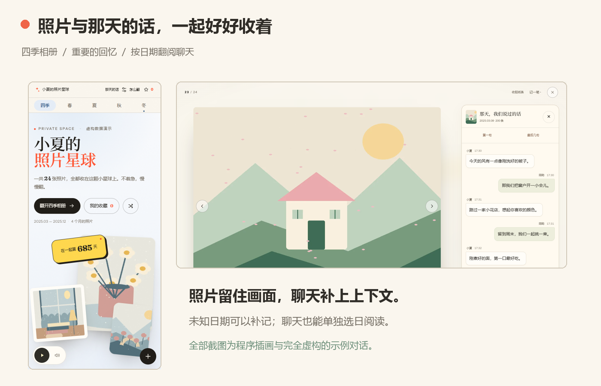
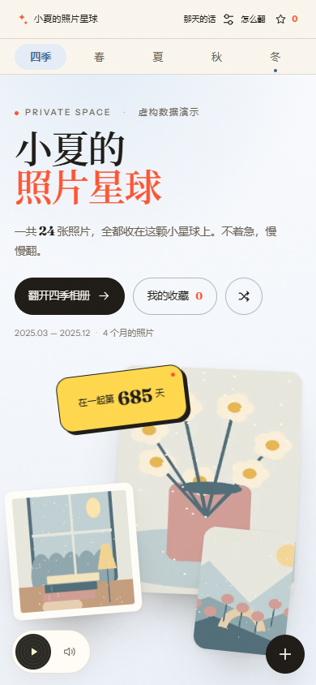
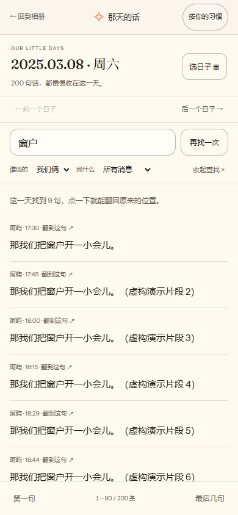
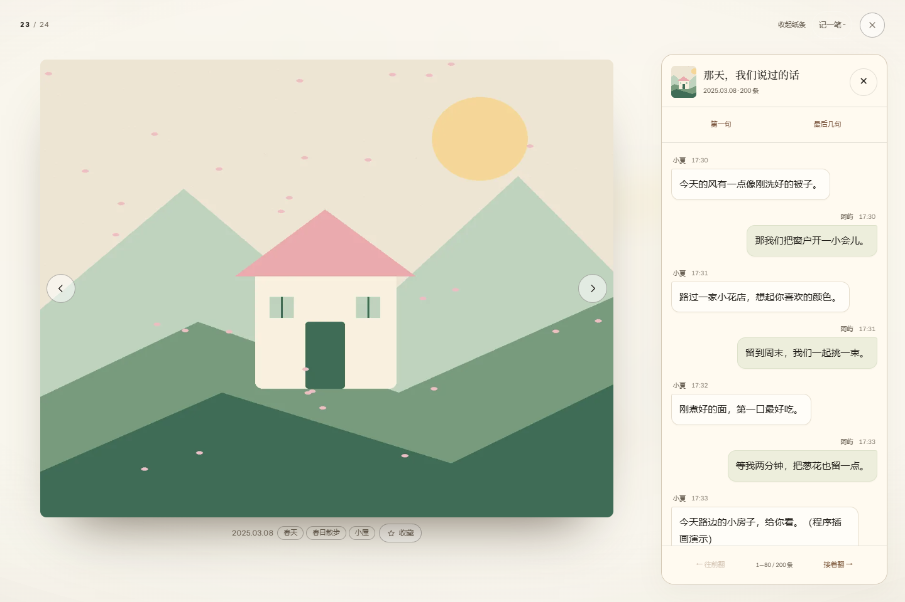
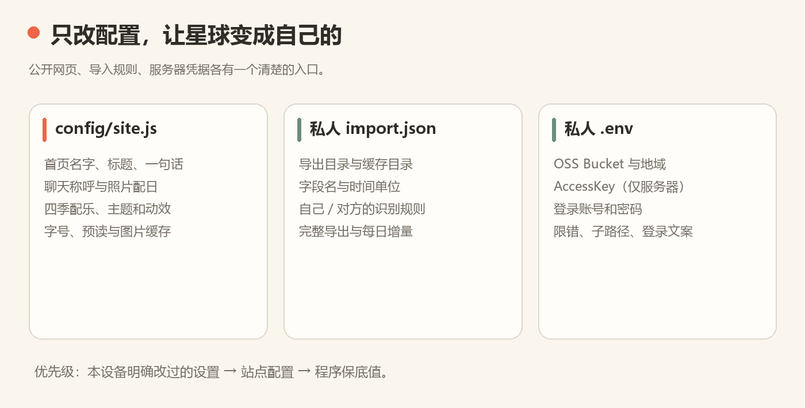
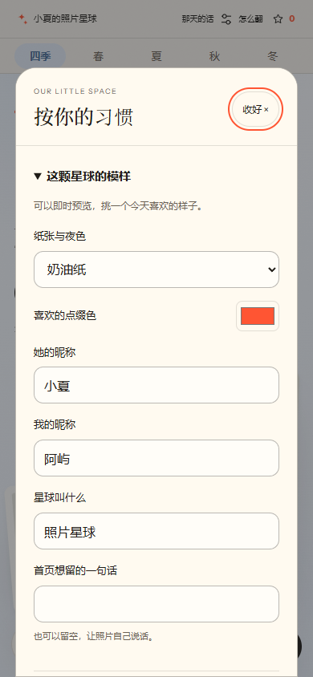
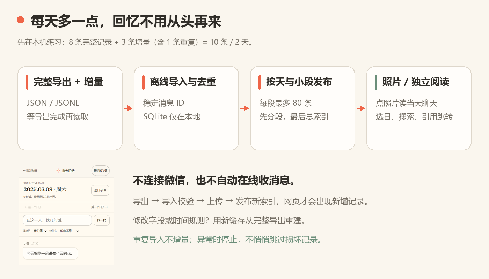
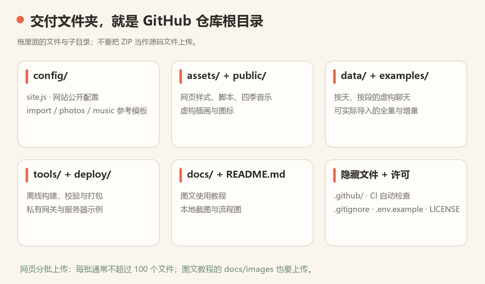

# 四季照片星球 · Photo Planet

**准备发布到 GitHub？先看 [逐项填写指南](GitHub发布填写指南.md)：从创建仓库到演示网址，每个字段都写明了。**

**把重要的照片，与那天说过的话，一起好好收着。**

一个像翻纸质相册一样的网站：春夏秋冬慢慢换页，音乐轻轻换季；点开一张照片，还能读到同一天的聊天。用来记录两个人的日常、朋友之间的小事，或任何不想忘记的回忆。



> 开箱即用的内容完全虚构：小夏与阿屿、纪念日、24 张程序插画、24 天共 1,280 条聊天，以及合成附件。不附带真实照片、微信导出或有效云凭据。

## 一分钟打开

Python 3.11+，无需前端构建、OSS 或数据库：

```sh
python -m http.server 5180 --bind 127.0.0.1
```

打开 <http://127.0.0.1:5180/>。Windows 可双击 `start.cmd`。不要用 `file://` 双击 HTML，聊天 JSON 需要 HTTP。

<p>
  
  
</p>

试试“春 → 打开照片 → 再翻翻那天的聊天”；或者顶部“那天的话 → 2025-03-08 → 搜窗户”。点击引用可回到原句，音乐首次播放需要点击。

## 照片之外，还有那天的上下文

照片留下画面，聊天里还留着出门前的一句“等我”、回家后的一句“今天真好”。把它们放回同一天，回忆就完整了一点。



- **照片与聊天联动**：按完整拍摄日期匹配，也能单独配另一天的话；未知日期不会乱猜。
- **独立阅读器**：日历、当天搜索、发送者筛选、引用定位、接着上次读；按段加载，默认最多保留附近 240 条消息节点。
- **四季与音乐**：季节筛选、星标、标签、日期补记，三种浏览方式；四季配乐交叉淡变，支持多套音频。
- **手机与平板优先**：网格读缩略图，点开高清预览，提前加载附近照片，可调省流与动效。
- **集中配置**：人物、标题、纪念日、文案、聊天关联、主题、音量与性能参数放配置文件。
- **增量更新**：完整聊天导出与后续增量按稳定 ID 去重，无需常驻 Python、Java 或聊天数据库。

## 不翻业务代码，也能改成自己的



打开 **[config/site.js](config/site.js)**，修改 `people.her`、`people.me`、`site.title`、`site.note`、`together.since`。配置文件带中文注释。保存刷新后，首页与聊天昵称一起改变。

网页里明确改过的个人设置优先；点“恢复默认”回到配置默认值。正文称呼可独立按字面替换，搜索使用替换后的文字；不修改原始导出或 OSS。**OSS Key 和登录密码只放服务器配置，不放前端。**



## 图文教程

| 想完成什么 | 教程 |
| --- | --- |
| 第一次打开、看演示、改名字 | [图文上手](docs/GETTING-STARTED.md) |
| 首页、称呼、音乐、时间、尺寸、性能 | [配置全解](docs/CONFIGURATION.md) |
| 微信导出、字段映射、照片配日、全量与增量 | **[微信聊天与照片联动](docs/WECHAT-LINK.md)** |
| Key 放哪里、权限与上传计划 | [OSS 与服务器配置](docs/OSS-SETUP.md) |
| 静态演示、HTTPS 私人站点、Docker | [部署说明](docs/DEPLOYMENT.md) |
| 不写命令，拖文件夹到 GitHub | [GitHub 上传图解](docs/GITHUB-UPLOAD.md) |
| 使用自己的真实记录前 | [私人数据说明](docs/PRIVATE-DATA.md) |

## 亲自验证全量与增量

```sh
python tools/demo_chat_import.py --out ../photo-planet-lab
python -m http.server 5181 --bind 127.0.0.1 --directory ../photo-planet-lab/site
```

打开本机 5181 端口。实验只读 `examples/chat/` 的虚构微信导出：先导入 8 条，再加入 3 条增量，去掉 1 条重复后得到 **10 条／2 天**。春天第一张插画可读到其中 9 条。实验目录必须是新的，不覆盖当前演示。



这是**已发布的离线聊天导出**，不连接微信实时收消息。流程是导出结束 → 本地导入校验 → 上传新分段 → 发布新索引与白名单。不同工具有字段差异；文字导入器不自动解密图片或转码所有附件。

## 使用自己的资料

先在独立私人副本执行一次：

```sh
python tools/prepare_private.py --confirm
```

它取消跟踪演示数据和个人配置，不删除磁盘文件。原图、导出、增量、缓存与凭据存仓库外；`.gitignore` 不能清理已提交的历史。**私人聊天不要放公开 GitHub／Pages；只换昵称不足以脱敏。**

照片导入需要 Pillow 和 PATH 中的 `ffmpeg`／`ffprobe`：

```sh
python -m pip install -r requirements.txt
python tools/build_photos.py --src ../photo-planet-private/photos
```

将 `config/import.example.json` 复制到仓库外，配置自己的路径与字段映射，再执行：

```sh
python tools/build_chats.py --config ../photo-planet-private/import.json
```

详细步骤见教程。网页“添加照片”、星标和设置主要保存在本设备，不自动上传 OSS 或跨设备同步。

## 目录一览



```text
config/                    唯一站点配置与导入、音乐参考模板
assets/js、assets/css       无框架前端
assets/audio               作者授权的 AI 四季配乐
assets/fonts、LICENSES      自托管字体与许可
public、data、demo-media     仅虚构插画与聊天
examples/chat              可以实际导入的虚构微信导出
tools/                    离线构建、校验、实验与打包
deploy/                   可选 Node OSS 网关、Nginx、Docker
docs/images               实际界面截图与原创说明图
index.html、chat.html       相册与独立聊天页
```

基础页面不需构建。Node.js 22+ 用于可选私有网关及开发检查。Docker 本机演示：`docker compose up -d --build`，访问 <http://127.0.0.1:8080/>；默认只有虚构演示，没有私人数据鉴权。

## 开发验证

```sh
npm ci
npm run check:config
npm test
python -m pip install -r requirements.txt
python -m unittest discover -s tools -p "test_*.py"
npx playwright install chromium
npm run test:browser
python tools/check_public.py
```

浏览器流程覆盖手机／平板视口、子路径、照片聊天、搜索、设置和音频解码。Windows WebKit 测试引擎缺少 Web Audio API，配乐播放会明确跳过。真实 iPhone／iPad 和 Docker／云部署仍需在各自环境验收。GitHub Actions 包含配置、Node、Python、浏览器与公开数据检查。

## 许可与边界

代码、原创演示和作者授权的 AI 音乐默认使用 [MIT](LICENSE)；字体保留 SIL OFL，详见 [ASSETS.md](ASSETS.md)。自行导入的照片、聊天和音乐不会自动成为本项目的开源资源。

聊天搜索限所选一天；网页添加没有云端直传；部署示例不自动创建 OSS、DNS 或证书；浏览器缓存可能被回收。希望这个相册能陪你记录重要的小事，也让你清楚这些回忆存在哪里。
