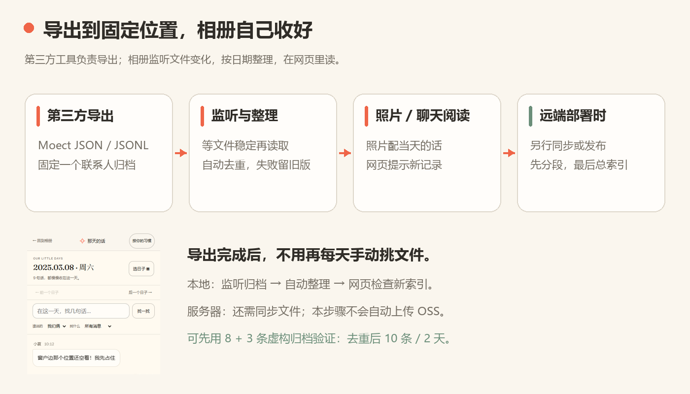

# 第三方导出后，相册自己更新

平时继续用你熟悉的工具导出聊天。让它把 JSON 保存到一个固定位置，再让相册的监听程序留在后台。以后归档有变化，相册就会重新整理；相同消息不会多一份。



## 适用于哪些导出

本项目不导出微信聊天，也不读取微信进程或数据库。这次适配的是 **Moect 1.2.8 的 JSON／JSONL 导出**，包括把新增消息追加回原 JSON 文件的增量同步版。兼容性依据该版本的序列化字段编写；其他版本仍需对照结构。

工具安装目录和聊天输出目录是两回事。配置 `source` 时填的是**已导出的聊天 JSON 文件**，不是 Moect 程序文件夹，也不是微信数据库文件夹。推荐直接指定某位联系人的那一个 JSON，最不容易混入其他联系人、资源报告或合并转发文件。

HTML、压缩包、加密包不能直接交给此监听器。请在第三方工具里选择 JSON。附件暂时显示文字占位；本流程不复制聊天图片、不解密媒体、不转码语音。

## 先用示例试一遍

还没准备好真实导出也能体验相同流程：

```sh
python tools/demo_chat_import.py --format moect --out ../photo-planet-moect-lab
python -m http.server 5181 --bind 127.0.0.1 --directory ../photo-planet-moect-lab/site
```

打开本机 5181 端口。实验用 [Moect 结构的虚构 JSON](../examples/moect/README.md) 导入 8 条，再增加 3 条，其中 1 条重复，最后页面显示 10 条／2 天。实验目录必须是新的，不会使用你的微信资料。

## 1. 准备一个私人副本

保留开源副本用来提交代码，另复制一份给自己的照片和聊天。在**私人副本**的终端执行：

```sh
python tools/prepare_private.py --confirm
```

这一步让个人配置与生成数据不再被 Git 跟踪，不会删除本地文件。真实资料不要部署到公开 GitHub Pages。

建议目录：

```text
projects/
  photo-planet/                 私人网站副本
  photo-planet-private/
    import.json                 监听配置
    moect-cache/                程序创建的去重缓存
  chat-exports/
    selected-contact.json       第三方工具导出的那一个会话
    selected-contact_assets/    导出工具的附件（本次不读取）
```

## 2. 写好导入配置

把 [`config/import.moect.example.json`](../config/import.moect.example.json) 复制到 `photo-planet-private/import.json`。改成自己的路径：

```json
{
  "version": 1,
  "paths": {
    "source": "../chat-exports/selected-contact.json",
    "output": "../photo-planet/data/chat",
    "stateDir": "./moect-cache"
  },
  "import": {
    "format": "moect",
    "expectedChatId": "contact-demo",
    "filePatterns": ["*.json"],
    "fields": {}
  }
}
```

| 要填的地方 | 填什么 |
| --- | --- |
| `source` | 第三方工具生成的 JSON 文件完整路径；也可填仅含这一个会话的归档目录 |
| `output` | 私人网站的 `data/chat`，不要指向原始导出 |
| `stateDir` | 去重缓存，必须在网站和原始导出目录之外，日常更新保留它 |
| `format` | Moect 填 `moect`；旧的通用格式填 `standard` 或省略 |
| `expectedChatId` | 原 JSON 开头 `metadata.session` 的值，不能用昵称代替 |
| `filePatterns` | 仅在 source 是目录时使用；JSON 为 `*.json`，JSONL 为 `*.jsonl` |
| `fields` | Moect 留 `{}`，不需要自己逐项映射 |

所有相对路径都以 **import.json 所在目录**为起点。Windows 绝对路径可以写 `D:/chat-exports/selected-contact.json`；反斜线需写成双反斜线。不要把示例 `contact-demo` 原样留着。

首次导入会用这份源数据建立新的聊天目录索引。旧演示分段即使留在磁盘也不会混进新索引。换联系人或更改字段规则时，换一个新缓存目录，从完整导出重新建立。

## 3. 先导入一次

等第三方导出任务完成后，在私人网站目录执行：

```sh
python tools/watch_chats.py --config ../photo-planet-private/import.json --once
python -m http.server 5180 --bind 127.0.0.1
```

打开 <http://127.0.0.1:5180/chat.html>。日期目录有记录，点开当天能看到双方的话，就说明接好了。相册里照片有完整日期时，点开它还能读到同一天的聊天。

`--once` 用于已经导完后的单次检查；不等待文件稳定。控制台只输出条数、日期数等统计，不输出正文。不要把这个仅供本机测试的 HTTP 服务直接暴露到公网。

## 4. 开始自动监听

再开一个终端，留着运行：

```sh
python tools/watch_chats.py --config ../photo-planet-private/import.json
```

现在去第三方工具执行增量同步。它改写同一个 JSON 后，监听器默认每 2 秒检查文件大小和修改时间，连续 5 秒不变才导入。没有变化时不反复读取整个文件。大归档变化后仍需流式扫描与校验，耗时取决于实际大小，不是瞬间完成。

- 新记录按稳定消息编号去重；没有服务端编号时使用分库编号和本地编号。
- `.partial`、临时文件和隐藏目录不参与导入。
- 文件未写完、其他会话混入、身份字段不清楚时拒绝更新，网页继续显示上一版；稍后自动重试。
- 原始导出只读；删掉源文件不会让已归档消息同步消失。撤回、删除行为遵循第三方归档内容，不等于微信实时镜像。
- 按 `Ctrl+C` 停止监听；终端关闭或电脑关机后停止更新，已有页面数据仍在。

可调整等待时间，例如较慢的网络磁盘：

```sh
python tools/watch_chats.py --config ../photo-planet-private/import.json --poll 5 --settle 15
```

## 网页什么时候看到新内容

独立聊天页默认每 60 秒检查一次小索引；从后台回到页面时也会检查。新日期自动进入日历，有新记录时按钮会显示“有新收进来的话”。当前聊天保持位置，点按钮载入最新当天内容，再回到原来那句。重新打开页面直接读取最新索引。

这个检查间隔可在 `config/site.js` 的 `chat.indexRefreshMs` 改为 5000–300000 毫秒。它只影响网页检查索引的频率，不影响第三方导出速度，也不影响后台监听间隔。

## 以后部署到服务器呢

浏览器不能直接扫描电脑上的 D 盘，服务器也不能直接读取本机目录。监听器只负责**本机或服务器可访问路径 → 该网站的生成文件**，不会在这个步骤自动上传 OSS。

两种常见做法：

1. **本机整理后发布**：本机监听生成结果，沿用自己的发布流程上传新的日期分段，再更新索引。私有 OSS 网关部署还要同步其精确读取白名单，见 [OSS 配置](OSS-SETUP.md) 和 [微信联动](WECHAT-LINK.md)。
2. **同步原归档到服务器**：先把完成的 JSON 安全同步到服务器的非公开目录，在服务器运行监听器，输出到私人网站的数据目录。文件同步应先写临时文件再重命名，避免半成品。

发布时**分段在前、总索引在后**，不要先让手机读到还不存在的新分段。需要常驻时，用 Windows 任务计划或服务器的进程管理器运行上述监听命令；第三方工具的导出任务独立配置，不由本项目操控。

## Moect 字段怎样转换

| Moect 导出 | 相册识别方式 |
| --- | --- |
| `session` | 与配置的会话 ID 严格核对，仅一对一 |
| `create_time` | 秒级时间戳，统一按 UTC+8 分日；不靠本机时区猜时间 |
| `is_sender` / `sender_wxid` | 识别自己与对方；系统消息独立识别 |
| `text` / `type_name` | 显示正文和附件文字占位，不执行导出的 HTML/XML |
| `server_id` | 保留精确字符串，作为首选去重标识 |
| `shard` / `local_id` | 无 server_id 时的身份，防止不同分库本地编号相同 |
| `quote` / `extra.reply` | 显示引用快照；原句已导入且有服务端编号时可跳转 |

转发合集只显示第三方提供的摘要，不展开嵌套会话；不认识的发送者会停止导入，不擅自归到对方。
