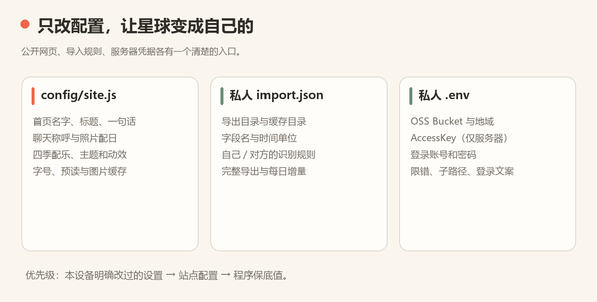
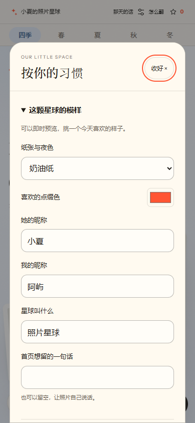
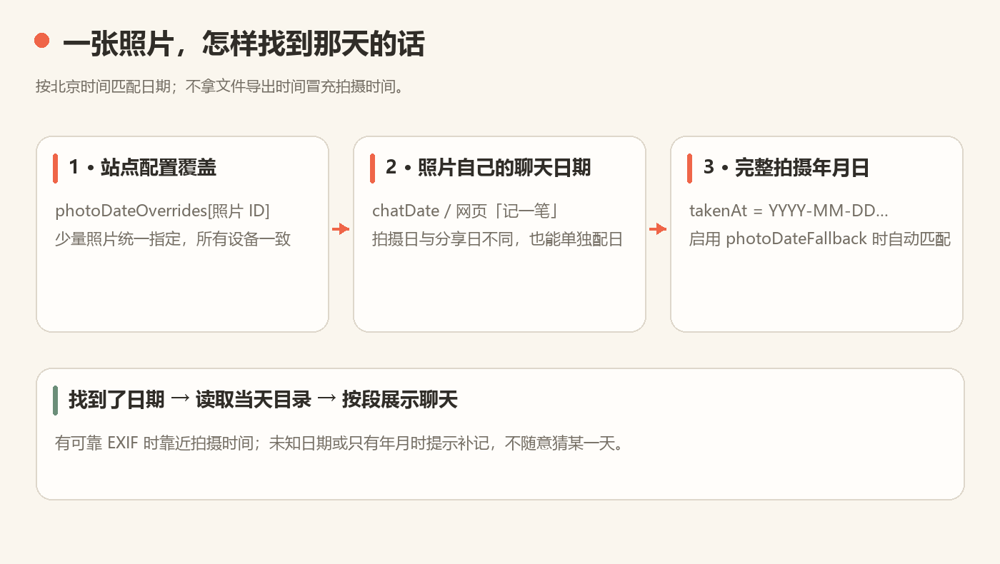
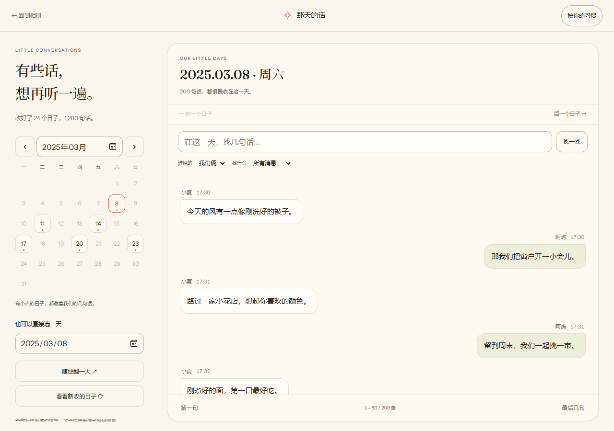

# 配置全解

**公开网页改 `config/site.js`；私人聊天导入改仓库外的 `import.json`；OSS Key 和密码只写仓库外的 `.env`。** 不需要编辑前端业务代码来换人名和标题。



## 配置在哪里加载

两个 HTML 页在读取个人设置前，先加载 `config/site.js`；`assets/js/site-config.js` 负责纯文字文案、显示替换和照片日期匹配。文件是 JavaScript，允许注释，字符串用引号，字段之间有逗号。修改完成可运行：

```sh
node tools/check_config.cjs
```

配置优先级：**本设备明确改过的个人设置 → `config/site.js` 默认值 → 程序保底值**。网页“恢复默认”回到配置文件中的默认值。`preferences.enabled: false` 会关闭设置入口并忽略已存个人设置。

## 人名与首页



| 配置项 | 含义／可用值 |
| --- | --- |
| `demo` | 标明演示模式；改为 false 不会自动删演示数据，也不提供鉴权 |
| `people.her` | 主人公／另一方昵称，1—12 字；首页和对方聊天气泡共用 |
| `people.me` | 自己的聊天昵称，1—12 字 |
| `people.system` | 系统消息显示名 |
| `site.title` | 首页第二行和浏览器标题中的相册名，1—20 字 |
| `site.nameSuffix` | 昵称与标题之间的文字，默认“的”，也可留空 |
| `site.description` | 页面 description 元信息 |
| `site.eyebrow` / `site.badge` | 截图里 `PRIVATE SPACE` 与右侧说明 |
| `site.note` | 首页额外的一句话，0—100 字；空字符串隐藏 |
| `site.heroLead` | 总照片数之前，例如“一共” |
| `site.heroAfterCount` | 照片数之后的文字 |
| `site.heroSecondLine` | 首屏说明第二行 |
| `site.albumButton` | 翻开四季相册按钮文字 |
| `site.chatTitle` | 聊天入口、独立聊天页标题 |
| `site.photoChatTitle/photoChatButton` | 照片旁聊天预览标题与展开按钮 |
| `site.photoChatReaderTitle/photoChatMappedTitle` | 照片聊天阅读标题与单独配日后的标题 |
| `site.chatEyebrow` | 聊天日期标题上方英文小字 |
| `site.galleryEyebrow` | 照片区上方英文小字 |
| `site.galleryTitles.all/fav/undated` | 全相册、收藏、未知日期的章节标题 |
| `site.footerLines` | 页脚文字数组，每个元素一行；无需写 `<br>` |
| `site.footerEyebrow` | 页脚英文小字 |
| `site.icon` / `site.touchIcon` | 同源图标路径，普通标签／iPhone 桌面图标 |
| `site.themeColor` | 浏览器主题色，六位十六进制颜色 |
| `site.robots` | 默认 `noindex, nofollow`；它不等于访问权限 |

所有文案按纯文字插入，不把配置内容当 HTML。比如 `` 会显示成文字。名字变更只作用于发送者标签；正文是否替换由下面的独立规则决定。

## 聊天名字、正文替换与照片联动

```js
chat: {
  // ……保留原有字段……
  senderAliases: { me: ['我', '自己'], her: ['对方', '旧昵称'], system: ['系统'] },
  textReplacements: [
    { from: '旧称呼', to: '新的小名' },
    { from: '原来的纪念地点', to: '那条小路' }
  ],
  photoDateOverrides: {
    'demo-spring-6': '2025-03-23'
  }
}
```

- `people` 决定标准发送者 `me/her/system` 怎么显示。
- `senderAliases` 把引用中的旧名字识别成标准发送者，不用正则，不重写原始导出。
- `textReplacements` 是精确、区分大小写的字面替换，最长原词优先，同一遍不连锁替换。最多 100 条；原词 1—80 字，替换值 0—160 字。
- 正文、引用文字、分享标题和转发中的显示文字会使用替换结果；消息 ID、引用目标、时间戳、附件路径与 URL 不变。
- 搜索针对替换后的显示文字。原始 JSON／OSS 下载文件仍保留原文，**这不是脱敏发布工具**。
- `photoDateOverrides` 的键是照片清单里的 `id`，值必须是真实存在的完整日期。优先级：配置覆盖 → 网页手动配给照片的聊天日期 → 完整拍摄年月日。



| 聊天配置 | 默认／范围／作用 |
| --- | --- |
| `enabled` | true；false 隐藏入口且不读取聊天数据 |
| `baseUrl` | `data/chat/`，聊天总索引所在目录，必须带可解析的分段结构 |
| `localAssetBaseUrl` | 演示为 `demo-media/`；私人 OSS 模式删除这个字段 |
| `initialDate` | 空字符串打开最近一天；填写 `YYYY-MM-DD` 可选初始日；URL 参数和有效阅读书签优先 |
| `photoDateFallback` | true；false 后只有显式配给的日期才关联，不使用照片日期兜底 |
| `photoDateOverrides` | 照片 ID 到完整聊天日期的映射 |
| `previewLines` | 6；1—12，照片旁预览几句 |
| `maxVisibleChunks` | 3；1—5，独立聊天页附近最多保留几段 DOM，每段最多 80 条 |
| `searchLimit` | 100；10—500，当天搜索最多显示多少结果 |
| `preloadPx` | 900；200—2400，独立聊天滚动预读距离，单位像素 |
| `requestTimeoutMs` | 20000；3000—60000，聊天请求超时，单位毫秒 |
| `indexRefreshMs` | 60000；5000—300000，聊天总索引内存复用时间 |
| `dayCacheEntries` | 16；1—64，日期目录内存缓存数量 |
| `chunkCacheEntries` | 32；2—128，聊天分段内存缓存数量 |

日期归档固定为北京时间（UTC+8）。更换季节月份不改变聊天日期。没有完整年月日的照片不会自动猜聊天日。

## 主题、照片布局与性能

`preferences` 是所有访客首次打开时的默认值，也能由网页设置面板逐项覆盖。

| 字段 | 可用值 |
| --- | --- |
| `enabled` | true/false，是否开放个人设置入口 |
| `theme` | `cream` / `rose` / `sage` / `night` |
| `accent` | 例如 `#ff5533` |
| `columns` | `auto` / `1` / `2` / `3` / `4`，字符串；自动模式按屏幕宽度安排 |
| `spacing` | `compact` / `cozy` / `airy` |
| `width` | `narrow` / `cozy` / `wide`，平板与桌面最大宽度 |
| `fit` | `cover` 铺满 / `contain` 完整显示 |
| `hero` | `favorites` 星标优先 / `latest` 最近 / `shuffle` 随机 |
| `motion` | `light` / `off`，装饰动效也尊重系统减少动态效果 |
| `preload` | 1 / 2 / 3，照片流预加载屏数 |
| `saver` | true/false，省流时不准备相邻高清图 |
| `cacheMB` | 16 / 48 / 96，私有签名照片缓存容量 |
| `chatFont` | 整数 13—22，聊天字号 |
| `chatSpacing` | `compact` / `cozy` / `airy` |
| `chatAlign` | `bubbles` / `left` |
| `chatMedia` | `auto` 快看到再载入 / `tap` 点击再载入 |
| `resumeChat` | true/false，记住阅读位置 |



| 其他字段 | 作用 |
| --- | --- |
| `loading.photoConcurrency` | 1—6，私有媒体加载器下载并发；默认 4。普通静态图片仍由浏览器调度 |
| `loading.cacheDays` | 1—30，私有照片 CacheStorage 保留期；默认 7 天 |
| `loading.maxImageMB` | 1—20，允许写入私有照片缓存的单张图片大小；默认 8 MB |
| `gallery.minRatio/maxRatio/tallRatio` | 网格卡片的宽高比裁切边界；默认 0.72 / 1.55 / 0.56 |
| `features.addPhotos` | true/false，显示本设备添加照片按钮；它不上传到服务器 |
| `storage.favKey` | 星标 localStorage 键；更换键会使用另一份本设备星标集合 |
| `storage.preferencesKey` | 个人设置存储键；多站点共用同一域名时可换不同键 |
| `places` | 可选旧清单地点名称映射；通常留空，本站不会查询在线地图 |
| `photoSource.mode` | 保留的兼容字段；当前使用本地生成清单，设为其他字符串不会自动接入云相册 |

CacheStorage 优化针对启用签名媒体的私有部署；演示静态资源使用浏览器普通 HTTP 缓存。缓存可能被系统清理，不替代备份。图片流里的缩略图和大图预览已分开，不必把并发开到最大。

## 纪念时间、彩带与四季

```js
together: {
  enabled: true, since: '2025-01-01T00:00:00+08:00',
  prefix: '一起走过第', suffix: '天', confetti: true
},
seasons: {
  enabled: true, initial: 'autumn', effects: true,
  labels: { all: '四季', spring: '春', summer: '夏', autumn: '秋', winter: '冬' },
  names: { spring: '春天', summer: '夏天', autumn: '秋天', winter: '冬天' },
  months: { spring: [3,4,5], summer: [6,7,8], autumn: [9,10,11], winter: [12,1,2] }
}
```

日期必须带时区；开始当天显示第 1 天。`confetti: false` 关闭票据彩带；`seasons.effects: false` 关闭季节粒子。`seasons.enabled: false` 关闭季节背景和导航，不删除照片季节字段。`initial` 是照片进入视口前的初始季节，之后跟随当前照片与选择。

南半球可把四组月份分别换成 `[9,10,11]`、`[12,1,2]`、`[3,4,5]`、`[6,7,8]`，必须完整覆盖 1—12 月且不重复。这个设置在浏览器按日期重新推导季节，离线照片清单中保留原生成季节。

## 音乐：自己的四季一组组换

| 字段 | 说明 |
| --- | --- |
| `music.enabled` | false 不创建播放器，也不请求音乐 |
| `music.autoplay` | 默认 false；true 只表示尝试播放，仍受浏览器手势限制与上次暂停选择影响 |
| `music.volume` | 初始音量 0—1；本设备调过的音量优先 |
| `music.fadeSeconds` | 切季节淡变 1—20 秒，默认 7 |
| `music.chatDuckVolume` | 播放聊天音频时的配乐音量系数 0—1，默认 0.18 |
| `music.sets` | 音乐套组数组，至少一组；两组及以上可点“换一组”随机选择另一组 |
| `sets[].id/title` | 稳定唯一 ID 与套组显示名 |
| `sets[].format` | `stems` 双声部，或 `tracks` 每季一首完整音乐 |
| `sets[].baseUrl` | 此套组目录；空字符串使用 `media.musicBaseUrl` |
| `sets[].duration` | 双声部模式精确循环秒数；整曲模式可写 0，让解码结果决定长度 |
| `sets[].titles` | 春夏秋冬各自的显示曲名 |
| `sets[].tracks` | 整曲模式四季文件名，可用字符串或格式回退数组 |

完整参考见 [`config/music-tracks.example.js`](../config/music-tracks.example.js)。它不会自动加载：放入自己的音频，再把对象复制进 `music.sets`。普通完整歌曲能淡入淡出，但不保证节拍／调性同步；想要音乐结构也自然衔接，制作时应统一 BPM、调性、循环点和响度。

## OSS 地址与 Key

公开配置中只放这些地址：

```js
media: {
  signedUrls: true,
  signedHost: 'YOUR-BUCKET.oss-YOUR-REGION.aliyuncs.com',
  photoBaseUrl: 'media/',
  musicBaseUrl: 'media/assets/audio/stems/'
}
```

**`AccessKeyId`、`AccessKeySecret`、登录密码不属于这个文件。** 它们在服务器端的 `.env` 中，步骤见 [OSS 配置](OSS-SETUP.md)。改地址本身不会上传任何文件，也不会自动生成云服务。

## 照片导入尺寸与画质也可配置

将 `config/photos.example.json` 复制到仓库外的 `../photo-planet-private/photos.json`，修改：

```json
{
  "version": 1,
  "source": "./photos",
  "thumbWidth": 640,
  "fullWidth": 1600,
  "quality": 78,
  "workers": 2
}
```

`source` 相对于配置文件；缩略图宽度 320—1600，高清预览宽度 640—4096 且不小于缩略图；质量 40—95；并发 1—8。`--src` 显式参数优先于配置路径。

在已准备好的私人副本执行：

```sh
python tools/build_photos.py --config ../photo-planet-private/photos.json
```

改变尺寸或质量会生成新派生文件名，避免旧浏览器缓存继续显示旧画质；原图和照片 ID 不变。旧派生图不会自动删除，以免破坏仍在打开的旧页面。手机为主可先用 640／1600、质量 78、并发 2，再按实际观感调整；EXIF／日期目录识别和未知日期的处理原则不变。
