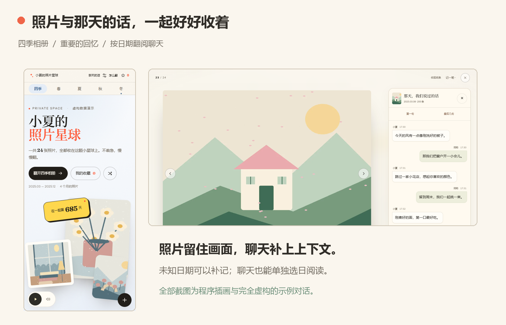
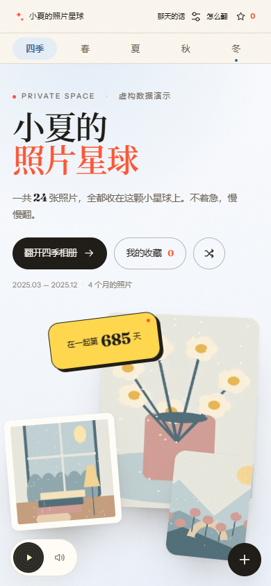
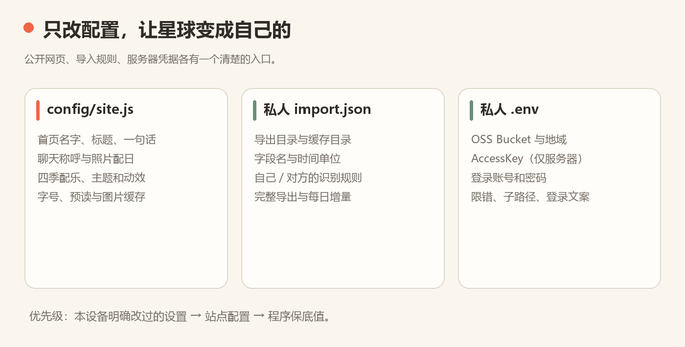
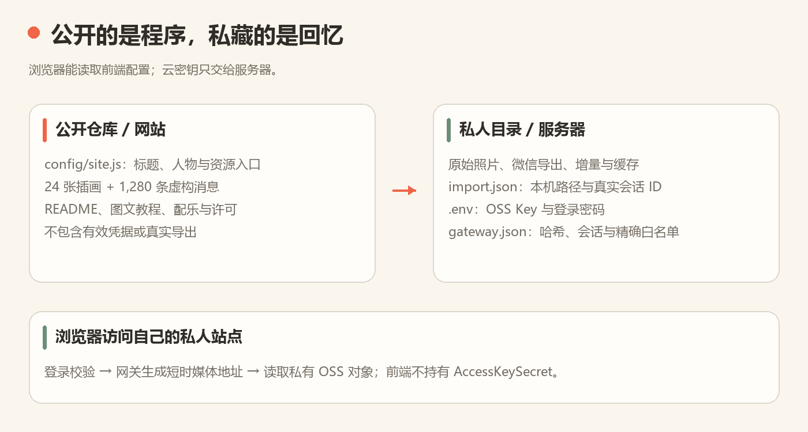
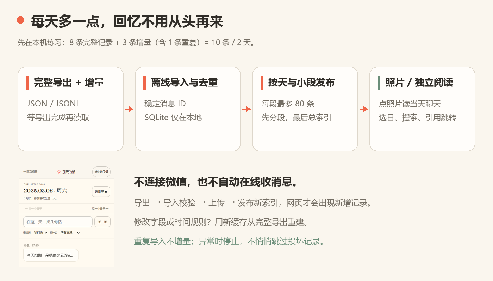

# 从一颗空星球，到自己的回忆

这是一份照片相册 + 微信聊天导出阅读器。点击照片，可以翻到同一天的话；也可以单独按日期读聊天。它不会登录微信，不会发送消息，也不会直接监听微信的新消息。



## 1. 先看一看，不填任何 Key

需要 Python 3.11+。下载仓库并解压，进入能看到 `index.html` 的目录，执行：

```sh
python -m http.server 5180 --bind 127.0.0.1
```

Windows 可直接双击 `start.cmd`。浏览器打开 <http://127.0.0.1:5180/>。不要双击 HTML 以 `file://` 打开，因为聊天使用 HTTP 读取 JSON。

自带 **24 张程序插画、24 天共 1,280 条虚构聊天**，以及四季配乐。没有 OSS、账号、服务器或真实照片也能完整体验。



可以依次试试：

1. 点击“春”，再点击一张照片；大图旁会出现这一天的聊天纸条。
2. 点击“翻开那天的话”，继续看完整消息。
3. 顶部“那天的话”进入独立聊天页；选 `2025-03-08`，试搜“窗户”。
4. 点有引用的消息，跳到原句；点“回到刚才”返回。
5. 点音乐按钮，再切春夏秋冬，听约 7 秒交叉淡变。
6. 点“怎么翻 → 按你的习惯”，改主题、字号和昵称；点黄色票据会蹦出彩带。

声音首次播放需要浏览器允许，iPhone 通常需要一次点击。独立聊天页不会自动加载音乐或整份相册。

## 2. 改首页名字，不翻代码

打开 **`config/site.js`**，这是网站唯一的公开站点配置入口。

```js
people: { her: '桃桃', me: '树树', system: '日子里的小记号' },
site: {
  title: '回忆小屋',
  nameSuffix: '的',
  // ……保留文件中其他字段……
  eyebrow: 'OUR LITTLE HOME',
  badge: '重要的小事，都在这里',
  note: '照片不一定完美，但每一天都很珍贵。'
},
```

这是修改片段，**不要把整个配置文件删成上面几行**。保存、刷新后，首页和聊天昵称会一起改变。`people.me` 是自己发出的消息，`people.her` 是另一个人发出的消息。



网页里自行改过的设置会优先使用个人选择；改文件后仍看到旧名字时，在网页设置中点“恢复默认”。新版本只保存自己改过的选项，没有改过的选项会跟随新的站点默认值。

有 Node.js 时可检查拼写与取值：

```sh
node tools/check_config.cjs
```

输出 `passed: true` 表示配置检查通过。所有配置详见 [配置全解](CONFIGURATION.md)。

## 3. 改成自己的照片与聊天前，先分开两个目录



保留一个公开演示仓库，另外复制一个私人部署目录，例如：

```text
projects/
  photo-planet-public/       本仓库，仅虚构内容，上传 GitHub
  photo-planet/              独立私人副本，不当公开演示上传
  photo-planet-private/      原图、聊天导出、导入缓存、服务器凭据
```

在私人副本执行一次：

```sh
python tools/prepare_private.py --confirm
```

它取消 Git 对数据目录和 `config/site.js` 的跟踪，不删除本地照片。之后真实文件仍应放在仓库外。**`.gitignore` 不能抹掉已经提交的历史。**

照片导入需要 Pillow、PATH 中的 `ffmpeg` 和 `ffprobe`：

```sh
python -m pip install -r requirements.txt
python tools/build_photos.py --src ../photo-planet-private/photos
```

程序生成 WebP 缩略图和大图预览，不改原图；日期优先 EXIF，其次识别日期目录，不用导出时的文件修改时间冒充拍摄时间。完整年月日才能自动关联当天聊天，月精度和未知日期可以手动配一天。

## 4. 用虚构导出练习一次“全量 + 增量”

公开副本中执行，目标目录必须尚不存在：

```sh
python tools/demo_chat_import.py --out ../photo-planet-lab
python -m http.server 5181 --bind 127.0.0.1 --directory ../photo-planet-lab/site
```

打开 <http://127.0.0.1:5181/>。脚本只使用 `examples/chat/` 的虚构导出，不访问微信、真实聊天或 OSS。它先导入 8 条，再加入 3 条增量，其中 1 条重复，得到 **10 条／2 天**。

- 春天第一张插画对应 `2025-03-08` 的 9 条消息。
- 春天第二张用配置覆盖，配给 `2025-03-09` 的 1 条消息。
- 独立聊天页中能看到这两天，也能搜索新增内容。
- 实验数据和 SQLite 缓存都在新建实验目录，不覆盖仓库自带的 1,280 条演示聊天。



## 5. 真正导入、上传、部署

按顺序继续：

| 你要做什么 | 对应教程 |
| --- | --- |
| 改标题、昵称、时间、音乐、性能参数 | [配置全解](CONFIGURATION.md) |
| 导入微信文字记录、字段映射、增量更新 | [微信聊天与照片联动](WECHAT-LINK.md) |
| OSS Key 放哪里、怎样生成上传计划 | [OSS 与服务器配置](OSS-SETUP.md) |
| HTTPS、登录、Docker、服务器目录 | [部署说明](DEPLOYMENT.md) |
| 只用网页拖动上传 GitHub | [GitHub 上传图解](GITHUB-UPLOAD.md) |

## 常见问题

**改配置不生效？** 检查是否编辑了当前预览目录的 `config/site.js`，刷新页面；个人设置里点“恢复默认”；再运行配置检查。不要删星标来排查昵称。

**聊天一直加载？** 要通过 HTTP 打开；开发者工具看 `data/chat/index.json` 是否返回 200。私人模式还要确认登录、聊天分段白名单和 OSS 对象存在。

**为什么不能看到微信刚发的新消息？** 这是离线导出阅读器。新导出 → 重新导入 → 发布新索引后，网页才有新数据；索引内存缓存默认 60 秒，也可刷新页面。

**“添加照片”是否已上传？** 没有，这个按钮只存当前浏览器；跨设备使用需走离线导入与受保护的服务器发布流程。

**能直接把私人数据放 GitHub Pages 吗？** 不能。公开仓库和 Pages 的静态 JSON、照片都可被读取，隐藏按钮或 `noindex` 不是鉴权。
