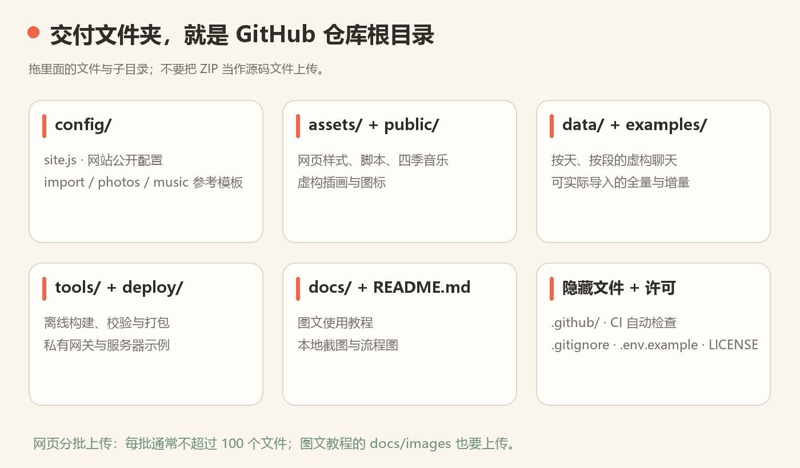

# 用网页把文件夹上传 GitHub

需要每个字段的填写说明，先看 [GitHub 发布填写指南](../GitHub发布填写指南.md)，本页是简版。

交付目录就是仓库根目录：打开后能直接看到 `README.md`、`index.html`、`config/`、`assets/`、`data/` 等。**上传目录中的内容，不要再套一层同名文件夹。** 不包含 `.git` 历史、真实照片、真实聊天、缓存或有效凭据。



## 网页上传

1. 在 GitHub 创建新仓库，名字可用 `photo-planet`，简介可用“按四季收藏照片，按日期翻阅聊天，让重要的小事有处可回”。
2. 新仓库点击“uploading an existing file”，已有仓库用“Add file → Upload files”。
3. 从本地打开交付文件夹，拖入**里面的文件与子目录**，保留相对路径。
4. GitHub 网页通常一次最多 100 个文件、单文件不超过 25 MiB。本项目有较多演示 JSON 和图片，建议分批提交：`assets/` 一批、`data/` 一批、`public/` 一批、其余内容一批；其他批次若也超过 100 就继续拆分。不要把整个 ZIP 当作源码上传。
5. 检查 `.github/`、`.gitignore`、`.gitattributes`、`.dockerignore`、`.env.example` 等隐藏名称文件是否都在。文件管理器若隐藏它们，开启显示隐藏项目。**不要上传 `.git/`。**
6. 每一批确认文件列表后点 Commit changes。完整上传后，根目录 README 会自动显示图片，Actions 的 Checks 会执行测试。

如果目录拖动被浏览器拦截，可改选文件，或使用 GitHub Desktop 发布同一目录；不要求你手写 Git 命令。图文截图在 `docs/images/`，要一同上传，否则 Markdown 图片会缺失。

## GitHub Pages 仅发布虚构演示

1. 仓库 Settings → Pages → Build and deployment，选择 `Deploy from a branch`。
2. 选择 `main` 和 `/ (root)`，保存。
3. 等 GitHub 完成 Pages 发布，使用页面给出的地址访问。
4. 应能看见插画、虚构聊天和音乐；首次播放需要点击。项目支持 `/<仓库名>/` 子路径，不需要改成根域名绝对路径。

如果看见 README 源码、404 或图片缺失，检查 `index.html` 是否位于根目录，以及是否上传了 `config/site.js`、`assets/`、`data/`、`public/` 和 `demo-media/`。

## 发布前最后检查

```sh
node tools/check_config.cjs
python tools/check_public.py
npm ci
npm test
python -m unittest discover -s tools -p "test_*.py"
```

不要在这里导入真人照片或私人聊天来做公开演示。自己的数据请在独立私人副本使用；原始导出、`.env`、`gateway.json` 和 SQLite 缓存都放仓库外。完整隐私说明见 [私人数据](PRIVATE-DATA.md)。

默认 MIT；字体保留 SIL OFL；项目作者授权的 AI 配乐随包提供。许可明细见 [ASSETS.md](../ASSETS.md)。真实手机播放与私人服务器部署仍需单独验收。
