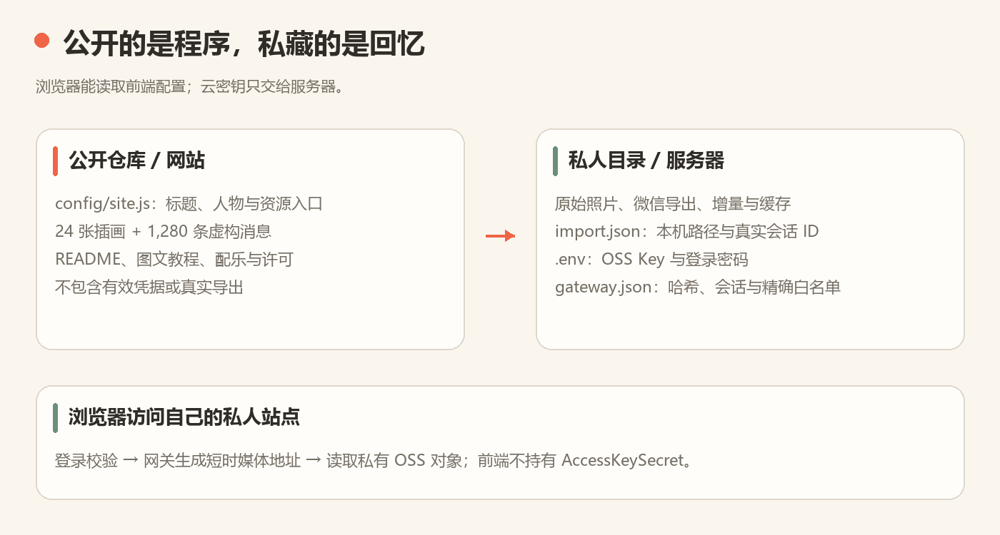

# OSS Key、资源上传与服务器配置

本地虚构演示完全不需要 OSS。选择私有云部署时，照片、聊天、音乐可放私有 Bucket；浏览器登录后从自己的网关取短时地址，再直接读取媒体。



## 1. 三类配置分开放

| 配置 | 位置 | 内容 |
| --- | --- | --- |
| `config/site.js` | 可公开网站 | 标题、昵称、媒体入口地址、聊天功能 |
| `import.json` | 仓库外、本地导入机 | 导出目录、字段映射、真实会话 ID |
| `.env` → `gateway.json` | 仓库外、服务器挂载 | OSS 凭据、登录账号、密码哈希、随机会话密钥、资源白名单 |

浏览器能下载所有前端 JS；所以 **不能把 OSS AccessKeySecret 放进 site.js**。`.env.example` 只是空白模板，不包含有效凭据。

## 2. 准备阿里云

1. 建一个私有 OSS Bucket，记下 Bucket 名和所属地域。
2. 创建专用 RAM 身份，不用主账号 Key。运行网关只读指定照片／音乐／聊天对象；上传使用另一个有相应前缀写权限的身份或临时凭据。
3. 确认 Key 所属身份能读到目标 Bucket，Endpoint 和地域一致。403 先检查身份、Bucket、资源前缀和授权策略；更换代码不能修复云端缺失权限。
4. Bucket CORS 只放行自己实际 HTTPS 网站 origin 的 GET／HEAD。例：`https://album.example.com`，不带 `/album/`。私有权限继续保留。

这里不自动创建 RAM、Bucket、CORS 或证书，也不自动替你给账号授权。

## 3. 把环境模板复制到仓库外

复制根目录 `.env.example` 到 `../photo-planet-private/.env`。填写：

| 变量 | 例子／说明 |
| --- | --- |
| `ALBUM_PUBLIC_ORIGIN` | `https://album.example.com`，HTTPS origin，不能含子路径 |
| `ALBUM_BASE_PATH` | `/album/`；域名根目录可用 `/`；同时修改 Nginx locations |
| `ALBUM_USERNAME` | 自己设置的登录账号；默认生成器按大小写不敏感校验 |
| `ALBUM_PASSWORD` | 自己生成的 12—256 字密码；不使用演示账号或公开固定密码 |
| `ALBUM_OSS_ENDPOINT` | 例如 `https://oss-cn-hangzhou.aliyuncs.com` |
| `ALBUM_OSS_BUCKET` | 自己的私有 Bucket 名 |
| `ALBUM_ACCESS_KEY_ID` | RAM AccessKey ID，仅服务器读取 |
| `ALBUM_ACCESS_KEY_SECRET` | RAM AccessKey Secret，仅服务器读取 |
| `ALBUM_CHAT_PREFIX` | 例如 `chatData/releases/release-001/`，以 `/` 结尾 |
| `ALBUM_LOGIN_TITLE` / `ALBUM_LOGIN_NOTE` | 登录页标题和一句说明，不再写死人物昵称 |
| `ALBUM_MAX_FAILURES` | 1—20，默认 5 次 |
| `ALBUM_FAILURE_WINDOW` | 1—86400 秒，默认 900，统计失败的时间窗 |
| `ALBUM_LOCK_SECONDS` | 1—86400 秒，默认 900，锁定时长 |

带空格等内容按 Node `.env` 语法加引号；不要把真实值贴进截图、公开 Issue 或 README。Linux 限制配置文件读权限；Windows 用 NTFS ACL 限制访问。

## 4. 从自己的清单生成服务器配置和上传计划

Node.js 22+：

```sh
node --env-file=../photo-planet-private/.env tools/configure_gateway.cjs ../photo-planet-private/gateway-empty.json
python tools/map_gateway.py --config ../photo-planet-private/gateway-empty.json --out ../photo-planet-private/gateway.json --plan ../photo-planet-private/upload-plan.json
```

第一条生成随机盐、密码哈希和会话密钥，不存明文登录密码；第二条读取当前照片／聊天清单，生成精确白名单及上传映射。两个工具都**不会上传**。输出文件必须在仓库外且不能已存在，避免覆盖正在使用的凭据；后续更新请使用新文件名。

`upload-plan.json` 的 `objects` 是“本地网站相对路径 → OSS 对象 Key”：

```json
{
  "version": 1,
  "objects": {
    "public/photos/thumb/example.webp": "photo/thumb/example.webp",
    "data/chat/index.json": "chatData/releases/release-001/index.json"
  }
}
```

这是结构示例，不是能直接上传的真实清单。用自己的生成文件作为依据，不要把所有文件随意拖到 Bucket 根目录。

## 5. 上传对象

可用 OSS 控制台、官方 ossutil 或自己的 SDK 上传器：

1. 按上传计划找到每一个本地文件，将目标 Key 设为映射值。上传工具的根目录应是私人网站运行目录。
2. 图片缩略图／高清预览与音乐先上传；聊天 chunk 和当天 index 先上传，总 `data/chat/index.json` 对应对象最后上传。
3. 对象保持私有。WebP 为 `image/webp`，JSON 为 `application/json`，Ogg 为 `audio/ogg`，FLAC 为 `audio/flac`，M4A 为 `audio/mp4`。
4. 新数据验收前保留上一代对象；当前工具不自动删除旧快照，也不自动保留历史白名单，若需要旧页面可读，合并保留的路径后再切换。

本仓库提供精确上传计划，不内置云端上传队列或网页直传服务。初次大量文件建议用 SDK 按计划批量执行，记录失败项，全部完成后再切换索引；不能只按文件夹名猜目标 Key。

## 6. 改前端地址与部署

在私人副本 `config/site.js` 中修改：

```js
demo: false,
chat: {
  // 保留其他聊天配置，删除 localAssetBaseUrl
  enabled: true, baseUrl: 'data/chat/'
},
media: {
  signedUrls: true,
  signedHost: 'YOUR-BUCKET.oss-YOUR-REGION.aliyuncs.com',
  photoBaseUrl: 'media/',
  musicBaseUrl: 'media/assets/audio/stems/'
}
```

`signedHost` 填真实 Bucket 域名，不带 `https://` 和路径。它用于检查网关返回的地址；不要留占位值。需要将原 config 中其他选项合并保留，而不是只留下本段。

接着按 [部署说明](DEPLOYMENT.md) 修改域名、证书与挂载目录；使用 `package_site.py` 生成运行文件，整个源码目录不作为 web root。所有页面、聊天 JSON、资源解析接口都要受登录保护。Nginx 示例以 `/album/` 为子路径，其他路径可与自己的服务并存。

上线验收包括：未登录读取被拒绝；账号密码可登录；连续输错触发限制；聊天日期、媒体跨域、短时地址过期后续签正常。限制计数只在单进程内存中，重启清空，多实例要做共享限流。

**本项目的 Docker 与云部署示例需要在你自己的环境验证；不意味着给配置填 Key 就已完成上线。**
