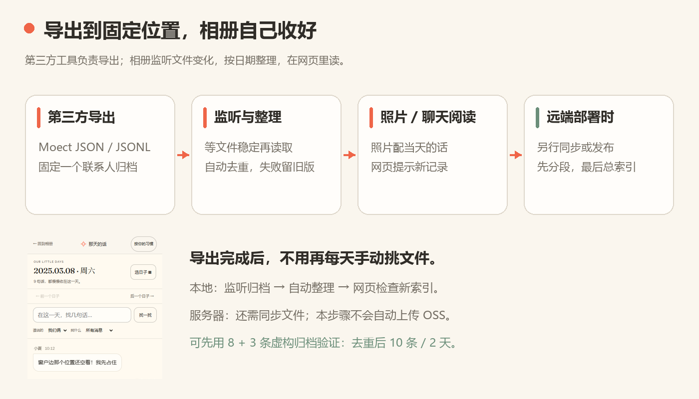
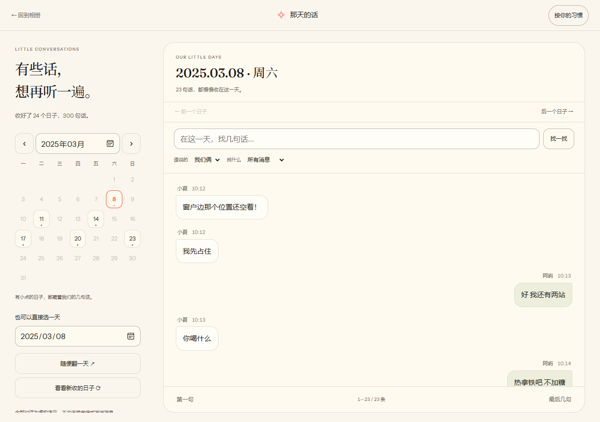
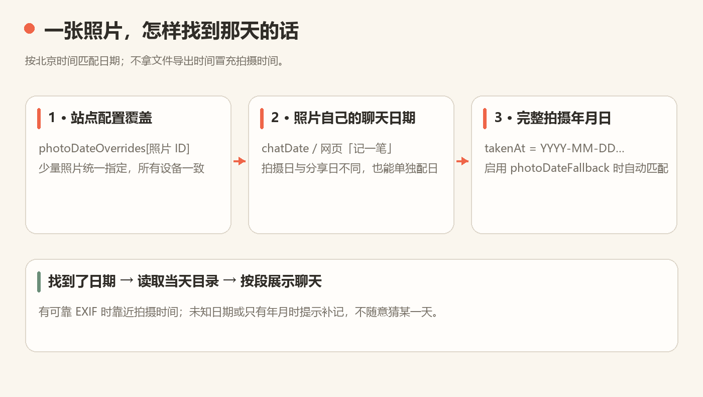
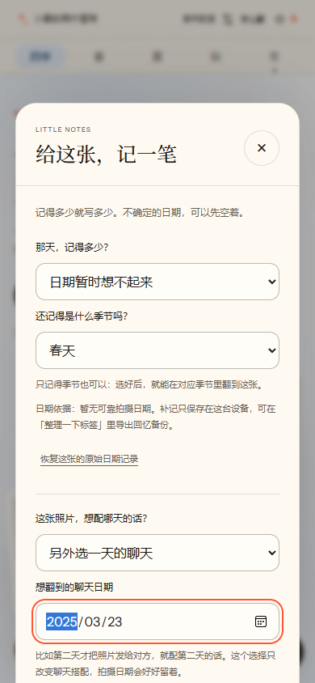

# 让照片与微信聊天，一起留在那一天

一张照片记录画面，聊天记录补上那天说的话。本站按**北京时间的日期**把二者联起来，浏览时只读取所选日期的小段 JSON，不把整份聊天历史塞进手机。


## 第三方工具已经在定期导出？

直接看 **[自动导入教程](AUTO-IMPORT.md)**：指定联系人 JSON → 启动监听 → 导出更新后自动整理。支持 Moect 1.2.8 增量版，下面保留通用格式的手动导入与字段映射说明。

## 先分清四个文件

| 文件 | 用途 | 能否放公开仓库 |
| --- | --- | --- |
| 微信工具导出的 JSON／JSONL | 原始聊天，只读输入 | 真实数据不能 |
| 仓库外 `import.json` | 路径、字段映射、发送者识别 | 可能含真实 ID，不要提交 |
| 仓库外 `chat-cache/archive.sqlite3` | 增量导入的本地缓存 | 不能，也不要放网站根目录 |
| 网站 `data/chat/` | 按天、按段生成的阅读数据 | 只有完全虚构演示可以公开 |

导入器不读取微信数据库，不参与解密。导出工具应先完整结束；把 `.partial` 等仍在写入的目录交给导入器，可能造成整次导入被拒绝。

## 1. 先用虚构聊天跑通

在公开副本运行：

```sh
python tools/demo_chat_import.py --out ../photo-planet-lab
python -m http.server 5181 --bind 127.0.0.1 --directory ../photo-planet-lab/site
```

打开 <http://127.0.0.1:5181/>，选择春天第一张插画，再展开聊天。你看到的是实际经过导入器产生的 9 条当天消息。另一天有 1 条，合计 10 条。



原始示例在 [`examples/chat/`](../examples/chat/README.md)：全量 8 条；增量 3 条，其中 1 条在全量里已有。重复消息使用会话编号＋服务端消息编号识别；没有服务端编号时，用会话＋源数据库＋本地编号，不靠正文相似度猜重复。

目标目录必须是新的。想再练习一遍，换一个 `--out` 名称即可。脚本不会扫描你的聊天目录、读取云凭据或连接微信。

## 2. 私人副本与原始导出目录

在独立私人副本执行一次：

```sh
python tools/prepare_private.py --confirm
```

建议结构：

```text
projects/
  photo-planet/                  私人网站副本
  photo-planet-private/
    import.json                  本机导入配置
    photos/                      原始精选照片
    chat-exports/
      full.json                  完整导出
      2025-03-09/
        聊天记录.json            后来的完整增量
    chat-cache/                  自动生成，不上传
```

也支持 JSONL 总记录。新旧导出可并存，重复消息会去重。不要把两个不同联系人／群聊放进同一个输入目录和缓存；本工具面向一对一会话。

## 3. 对照一个完整的可解析消息

```json
{
  "messages": [
    {
      "timestamp": 1741426200,
      "time": "2025-03-08T17:30:00+08:00",
      "sender": "我",
      "sender_username": "self-demo",
      "chat_username": "contact-demo",
      "type": "文本",
      "server_id": "10001",
      "local_id": 1,
      "source_database": "demo.db",
      "content": "今天有一点小小的开心。"
    }
  ]
}
```

| 字段 | 要求 |
| --- | --- |
| `timestamp` | 秒级整数；配置可指定毫秒输入 |
| `time` | 带时区的 ISO 时间，必须与 timestamp 一致，容许不超过 1 秒误差 |
| `chat_username` | 这一位联系人的稳定会话 ID |
| `sender` | 默认“我”视为自己、“系统”视为系统；其他须通过账号 ID 归属联系人 |
| `sender_username` | 发送者账号 ID；对方消息通常与 chat_username 相同 |
| `type` | 非空的文字类型，例如“文本”“引用消息”；数字类型码需先用相应导出工具转换 |
| `server_id` | 稳定服务端编号，优先用于去重 |
| `local_id` / `source_database` | 本地顺序；没有 server_id 时也作为稳定身份的一部分 |
| `content` | 导出的消息正文，引用可由已支持的文字结构解析 |

JSON 可以是对象里的 `messages` 数组，也可以直接是消息数组；JSONL 每行一个消息对象。**不是所有工具导出的任意 JSON 都能直接解析。** 字段在顶层但名字不同，可以用下一步映射；嵌套层级、加密附件或完全不同结构需要单独适配。

## 4. 写一份本机导入配置

把 `config/import.example.json` 复制到 **仓库外**的 `../photo-planet-private/import.json`，不要直接往公开示例文件里填真实账号。

```json
{
  "version": 1,
  "paths": {
    "source": "./chat-exports",
    "output": "../photo-planet/data/chat",
    "stateDir": "./chat-cache"
  },
  "import": {
    "expectedChatId": "contact-demo",
    "selfIds": ["self-demo"],
    "selfLabels": ["我", "自己"],
    "otherLabels": [],
    "systemLabels": ["系统"],
    "timestampUnit": "seconds",
    "deriveTime": false,
    "filePatterns": ["*.jsonl", "聊天记录.json", "*本机全部历史.json", "full.json", "increment*.json"],
    "fields": {}
  }
}
```

**路径相对于 import.json 所在目录**，不是命令行当前目录。上面示例与推荐目录结构对应；如果自己的私人网站目录叫别的名字，修改 `paths.output`。

| 导入选项 | 怎么填 |
| --- | --- |
| `expectedChatId` | 推荐填实际联系人会话 ID；空字符串允许首次从记录确定，随后缓存会固定此会话 |
| `selfIds` | 自己的发送者 ID 数组，可用于识别旧导出的“我” |
| `selfLabels` | 导出中表示自己的标签，默认 `["我"]` |
| `otherLabels` | 明确表示对方的标签；通常留空，按 sender_username 识别更可靠 |
| `systemLabels` | 系统标签，默认 `["系统"]` |
| `timestampUnit` | `seconds` 或 `milliseconds`，不要为了看起来像日期而随意更改 |
| `deriveTime` | 仅在缺失 time 时，从 timestamp 生成北京时间 ISO；已有 time 仍会核对，避免掩盖矛盾 |
| `filePatterns` | 只匹配文件名；递归查找源目录。不要填写目录、`../` 或反斜线 |
| `fields` | “本站标准字段”: “导出文件实际顶层字段”；空对象保持标准字段名 |

例如某工具用 `createTime` 毫秒数、`senderName` 和 `messageText`：

```json
{
  "timestampUnit": "milliseconds",
  "deriveTime": true,
  "fields": {
    "timestamp": "createTime",
    "sender": "senderName",
    "content": "messageText"
  }
}
```

把这个片段合并到 `import` 中，其他 ID、消息编号和类型字段仍须具备，不能只留这三个字段。发送者规则互相冲突时会停止，不把未知发送者默认归给另一半。

目录模式只读 `filePatterns` 匹配的文件；若源文件另有名字，要把名字加入模式，或者用 `--source` 显式传单个文件。专用导出目录可用 `*.json`，但不要混入工具设置、附件索引等非消息 JSON。

## 5. 首次导入与验证

在私人网站副本中运行：

```sh
python tools/build_chats.py --config ../photo-planet-private/import.json
```

也可继续用命令行参数；`--source`、`--output`、`--state-dir` 的显式参数优先于配置路径。

成功输出包含 `count`、`days`、`inserted`、`duplicates` 等统计。检查：

```sh
python tools/build_chats.py --config ../photo-planet-private/import.json --verify-output
python -m http.server 5180 --bind 127.0.0.1
```

访问 <http://127.0.0.1:5180/chat.html>，核对最早／最近日期，抽查双方昵称和午夜前后归档。消息时间统一按北京时间；**不是电脑当前时区，不按文件修改时间归档**。



生成结构：

```text
data/chat/
  index.json                           全部日期及计数
  days/2025-03-08/<内容版本>/
    index.json                         当天段落目录
    chunk-0000.json                    最多 80 条
    chunk-0001.json
```

段落使用内容版本地址；浏览器只读需要的段落。增量不要求手机重新下载整份历史。

## 6. 点击照片时，怎么决定哪一天



1. `config/site.js` 的 `chat.photoDateOverrides[照片ID]`。
2. 照片 `chatDate`，包括网页补记面板给这张照片配的一天。
3. 默认使用 `takenAt` 的完整年月日；`photoDateFallback: false` 可关闭这一兜底。
4. 只有年、只有月或未知日期时，提示补记，不把一整月乱配到某一天。

照片时间来自可靠 EXIF 且匹配当天时，会优先靠近拍摄时间的消息；单纯目录日期则从当天开头取预览。朋友圈照片如果按发布日期归档，匹配的也是发布日期，而不是凭空认定拍摄时间。

网页操作：点开照片 → “记一笔／给回忆做个记号” → 填拍摄日期或“配给这张的聊天日期” → 保存。



补记首先保存在本设备。要让所有设备共享，可从网页导出照片记号，导入照片清单：

```sh
python tools/build_photos.py --src ../photo-planet-private/photos --metadata ../photo-planet-private/照片记号.json
```

再发布新清单。少量统一关联也可直接放到 `chat.photoDateOverrides`，键值中的照片 ID 能从 `data/photos.json` 找到。照片 ID 不是原始文件名，换名不会随意破坏引用。

## 7. 后续每日增量

1. 等导出工具完成，把完整新增 JSON 放入 `chat-exports/日期/聊天记录.json`，或者把 JSONL 完整新行追加到总文件。
2. 继续使用同一 `import.json` 和同一 `stateDir`，重新执行导入命令。
3. 检查 `count` 增加量、`duplicates` 与 `daysPublished`，抽查新增日期。
4. 本机预览通过后再上传。先上传新聊天分段及当天索引，最后切换总索引。
5. 私有 OSS 网关同步生成新资源白名单并加载新配置；不要只上传 JSON 却忘记服务端白名单。

重复导入不会增加计数；源文件重写、截短不被当作“删除所有历史”。损坏文件会停止导入并保留上一份已发布目录，不会悄悄跳过异常行。

修改字段映射、时间单位或发送者规则后，需要**新的缓存目录**并从完整导出重建；否则旧记录可能沿用旧规则而只有增量用新规则。程序会拒绝这种规则混用。仅修改网页昵称不需要重建。

如果交给另一个 AI 设置定时任务，给它以下边界：

```text
只读取完整导出目录；不连接微信数据库。
保持同一个 import.json 与缓存目录，失败时停止发布并保留旧索引。
先本地导入和抽查，再发布分段、当天索引，最后发布总索引及匹配白名单。
不删除原始导出；不把导出、缓存、凭据提交到公开仓库。
规则发生变化时使用新缓存完整重建，不混用旧缓存。
```

## 8. 附件与“实时”的边界

示例里的图片与合成音效可以体验；前端也有受控附件渲染能力。但通用文字导入器不会自动解密微信图片、寻找任意工具的资源目录或转码所有语音视频。这些需按具体导出结构另做适配，不应把“文字已成功导入”理解为附件全齐。

这是**按需读取最新已发布快照**，不是与微信在线同步。更新频率取决于导出、导入和发布任务。不要把真实聊天挂公开 OSS 或 GitHub Pages；气泡换昵称和前端正文替换都不能消除源文件里的私人信息。
